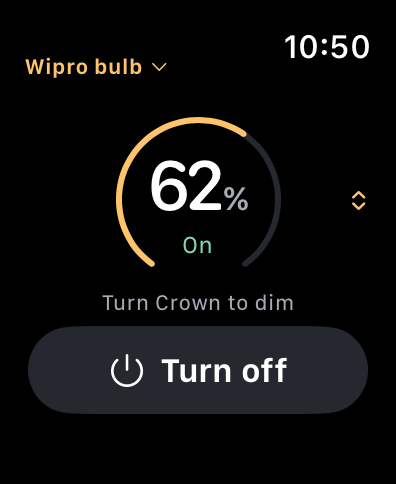

# Bulb Assist

An independent, experimental Apple Watch remote for supported Tuya Wi-Fi bulbs.
Turn a bulb on or off and adjust white-mode brightness with the Digital Crown.
The iPhone companion handles setup and transfers your connection to the Watch.

**Physically tested with one Wipro NS9001.** Other bulbs need the exact
[supported property schema](docs/compatibility.md); “Tuya compatible” alone is
not enough. One bulb is selected at a time. Sustained-use, latency and quota
validation remain unfinished; see the [hardware checklist](docs/validation/m4/hardware-run.md).

Routine commands go directly from Watch to the **Tuya cloud over HTTPS**.
Internet access and your own authorized Tuya End User API key are required for
live control. There is no Bulb Assist hosted backend or routine iPhone relay.



*Simulator screenshot, not evidence of a live command.*

## Try it without a bulb

Requires macOS with full Xcode, Swift 6, and iOS/watchOS 26 or newer SDKs and
simulator runtimes. Deployment minimums are iOS 26.0 and watchOS 26.0.
The release preparation was tested with Xcode 27.0 and 26.4 simulator runtimes.

```sh
make test
make build
open BulbAssist.xcodeproj
```

Choose the **BulbAssist** scheme and an iPhone simulator, then **Try the prototype**
on the welcome screen. For the **BulbAssistWatch** scheme, add `--prototype`
in **Edit Scheme → Run → Arguments**. These paths need no credentials.
XcodeGen is optional: the generated Xcode project is included.

For physical installation, your own signing team and bundle namespace belong in
an ignored local configuration. Follow [setup](docs/setup.md) for signing,
Smart Life pairing, key entry, provisioning and removal.

## How control works

Crown changes display immediately and coalesce into paced writes. While the
bulb is off, brightness selection stays local until **Turn on**. Backgrounding
discards unsent changes; returning reads fresh state. Uncertain writes reconcile
without replay, and rate limiting requires an explicit refresh after cooldown.
Power remains available outside white mode, but brightness does not.

Only power and brightness properties are written. The app does not change color,
color temperature or work mode. Cloud acknowledgement and visible lamp response
are different measurements.

## Development and reporting

- [Setup and commands](docs/setup.md)
- [Compatibility and tested devices](docs/compatibility.md)
- [Contributing](CONTRIBUTING.md), [privacy](PRIVACY.md), and [security reports](SECURITY.md)
- [Architecture and product specs](docs/specs/README.md)
- [Design previews](design/README.md) and [source release procedure](docs/release.md)

Tests use synthetic credentials and injected transports. Keep simulator test
sessions serialized. No live key or bulb is needed for CI.

## License and service conditions

Project code and original materials are available under [MIT](LICENSE), to the
extent the project holds the relevant rights. See [third-party notices](THIRD_PARTY_NOTICES.md)
for design assets and platform resources.

Bulb Assist is not affiliated with, endorsed by, or certified by Wipro or Tuya.
Those names identify compatibility only. Their trademarks and services remain
theirs. The MIT license does not grant cloud access or override provider terms.
The End User API is described as a trial; availability, eligibility, quotas and
costs may change. Review the [official API documentation](https://www.tuya.ai/developer/docs),
the terms shown when obtaining your key, and the
[scoped vendor review](docs/research/open-source-legal-review.md).
This release assessment covers source publication; signed binary distribution
and hosted or commercial services need a separate assessment.
